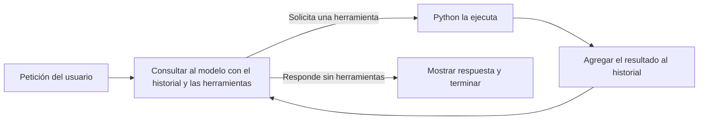

# BrayanCode

Un agente de programación en Python para acompañar el video **Construí mi propio Claude Code desde cero**.

La idea es sencilla: poner un modelo de lenguaje dentro de un `while`, darle herramientas y devolverle los resultados de lo que pide. Este repositorio permite ver ese ciclo en una interfaz web y observar sus mensajes JSON en la terminal.

## El cerebro y el arnés

El modelo es el cerebro: recibe una conversación y genera una respuesta. Esa respuesta puede ser texto para el usuario o una solicitud para usar una herramienta.

El arnés es el programa que conecta esa respuesta con tu máquina. Aquí está escrito en Python y ofrece tres herramientas:

| Herramienta | Qué ejecuta Python |
| --- | --- |
| `read_file` | Lee un archivo del proyecto. |
| `write_file` | Crea o sobrescribe un archivo y calcula el diff. |
| `run_terminal` | Ejecuta un comando y captura su salida y código de retorno. |

El modelo no abre archivos ni ejecuta comandos por sí mismo. Recibe un catálogo de funciones con sus argumentos y solicita una de ellas; Python se encarga de ejecutarla.

## El bucle



Esta es una versión reducida de `run_real_agent_stream`, omitiendo la interfaz, la telemetría y el manejo de errores. `ejecutar_herramienta` representa el despacho a las tres funciones locales:

```python
messages = [{"role": "system", "content": SYSTEM_PROMPT}] + historial
steps = 0

while steps < MAX_STEPS:
    steps += 1
    response = client.chat.completions.create(
        model=model,
        messages=messages,
        tools=TOOLS_SCHEMA,
    )
    assistant = response.choices[0].message
    messages.append(assistant)

    if not assistant.tool_calls:
        print(assistant.content)
        break

    for call in assistant.tool_calls:
        args = json.loads(call.function.arguments)
        result = ejecutar_herramienta(call.function.name, args)
        messages.append({
            "role": "tool",
            "tool_call_id": call.id,
            "content": result,
        })
```

Si un comando falla, su salida vuelve al modelo como resultado de la herramienta. El modelo puede pedir leer un archivo, escribir una corrección y ejecutar otro comando. No hay una secuencia de reparación programada de antemano: las siguientes acciones dependen de sus respuestas.

El turno termina cuando el modelo responde sin pedir herramientas. Eso no garantiza que haya resuelto bien la tarea; comprobar el resultado sigue siendo parte del trabajo.

## Qué JSON va y viene

Una solicitud del modelo para leer un archivo tiene esta forma:

```json
{
  "role": "assistant",
  "tool_calls": [
    {
      "id": "call_1",
      "type": "function",
      "function": {
        "name": "read_file",
        "arguments": "{\"path\":\"README.md\"}"
      }
    }
  ]
}
```

Python interpreta `arguments`, ejecuta `read_file` y añade el resultado:

```json
{
  "role": "tool",
  "tool_call_id": "call_1",
  "content": "# BrayanCode\n..."
}
```

El `tool_call_id` vincula el resultado con la solicitud correspondiente. Ese mensaje se envía al modelo en la siguiente petición, junto con el historial y el catálogo de herramientas.

Las comillas escapadas y los `\n` son parte de la representación JSON del texto. La interfaz los convierte en contenido legible; la telemetría permite observar los mensajes del protocolo, no los procesos internos del modelo ni una captura completa del tráfico HTTP.

## Dónde está la memoria

En este programa, la memoria es una lista: `CONVERSATION_HISTORY`. Cada petición envía el mensaje de sistema y el historial acumulado de mensajes del usuario, respuestas del modelo y resultados de herramientas.

El contexto anterior se conserva porque Python lo vuelve a enviar. El historial dura mientras está funcionando el servidor; el botón **Limpiar Chat** lo vacía y reiniciar el programa también lo elimina.

## Instalación y configuración

Necesitas Python 3.10 o posterior. Desde el directorio del repositorio, instala las dependencias:

```bash
python -m pip install -r requirements.txt
```

Copia `.env.example` como `.env` y configura estos valores. También puedes introducirlos desde el botón **Config** de la interfaz.

| Variable | Valor que debes proporcionar |
| --- | --- |
| `BASE_URL` | URL base de la API de tu proveedor. |
| `API_KEY` | Clave de acceso a esa API. |
| `MODEL` | Identificador exacto del modelo que quieras utilizar. |

Puedes usar un proveedor compatible con la API de Chat Completions de OpenAI, siempre que el modelo y su endpoint admitan llamadas a herramientas (`tool calling`). Configura `BASE_URL`, `API_KEY` y `MODEL` con los valores de tu proveedor.

El formato de mensajes y herramientas está documentado en la [referencia de Chat Completions](https://developers.openai.com/api/reference/python/resources/chat/subresources/completions).

El proyecto está construido **sin frameworks de agentes**. Usa el SDK de OpenAI para las peticiones, Flask para la interfaz web, Rich para mostrar la telemetría y python-dotenv para cargar `.env`.

## Ejecución

```bash
python agente.py
```

El servidor abre el navegador en `http://127.0.0.1:5000`. Para abrir también la telemetría:

```bash
python agente.py --telemetria
```

En Windows se abre una ventana de terminal aparte con el monitor. En otros sistemas, los mensajes JSON aparecen en la terminal del servidor. Envía una tarea desde la web para ver los eventos nuevos. El monitor que abre el agente se cierra al detener el servidor.

Para consultar la ayuda:

```bash
python agente.py --help
```

También puedes ejecutar `python telemetria.py` manualmente en otra terminal. El agente guarda los eventos en `telemetry_stream.jsonl`.

Prueba con una petición como: «Lee README.md y explícame cómo funciona el bucle de este agente». Para trabajar sobre otro proyecto, coloca una copia del agente y sus dependencias en ese directorio; las herramientas usan como raíz el directorio de `agente.py`.

Sin una clave configurada, el programa pide configurar la conexión. Todas las acciones mostradas durante un turno proceden del intercambio real con el modelo y de la ejecución local de herramientas.

## Dónde leer el código

- `agente.py`: `TOOLS_SCHEMA` declara las herramientas; `real_read_file`, `real_write_file` y `real_run_terminal` las ejecutan; `run_real_agent_stream` contiene el bucle y actualiza el historial. `HTML_PAGE` contiene la interfaz.
- `telemetria.py`: `render_event` muestra los mensajes del usuario, del modelo y de las herramientas. Su función `main` permite usarlo como monitor independiente.
- `.env.example` y `requirements.txt`: configuración y dependencias.

## Límites

Es un ejemplo educativo para uso local, con un historial compartido por la instancia del servidor. Cada turno permite hasta 20 llamadas al modelo; los comandos tienen un límite de 30 segundos.

`safe_path` restringe las rutas de lectura y escritura al directorio del proyecto. La terminal usa `shell=True` y ejecuta con los permisos del proceso: **no es un sandbox**. Sus comandos pueden acceder fuera de ese directorio.

El registro de telemetría puede contener texto de la conversación, archivos leídos y salidas de comandos. Está excluido de Git, al igual que `.env`.

## Licencia

[MIT](LICENSE).
